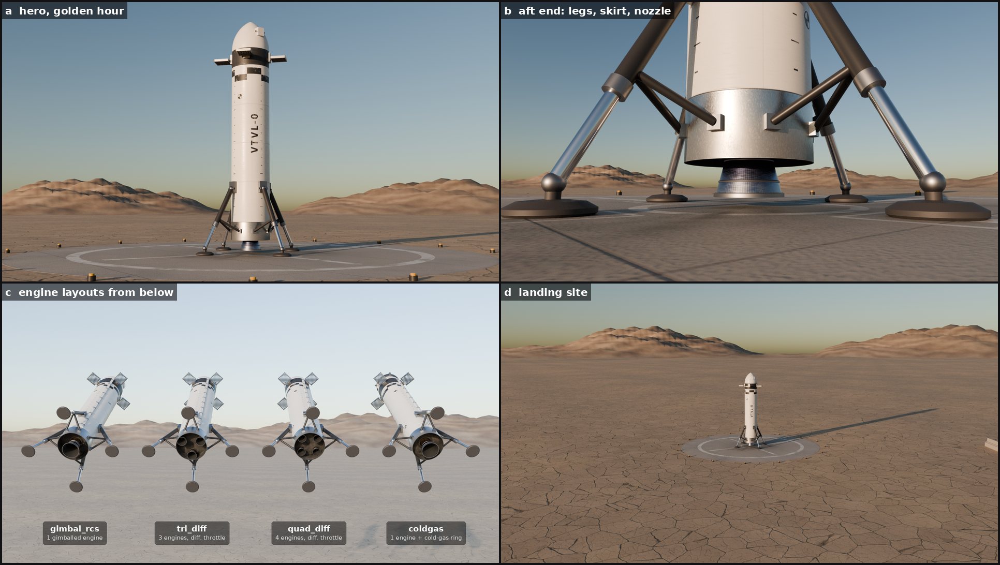

# VTVL v1 visual assets

Visual proxy of the rocket_dt VTVL test vehicle and a desert landing site, for Isaac Sim renders and videos.
This is **not** the physics model. These files hold no UsdPhysics schemas: no RigidBody, Mass or Collision API.
The physics stays where it is (the `build_vehicle_usd` cylinder hull and foot spheres in `rocket_env.py`). Reference
the vehicle visual under the physics rigid body, and keep the physics ground plane separate at z = 0.



## Files

| file | what it is |
|---|---|
| `vehicle_<layout>_<engine>.usd` | One per layout × engine (4 × 3 = 12). A small assembly whose default prim is `/Vehicle` (kind component). It references `parts/airframe.usdc`, `parts/coldgas_ring.usdc` (coldgas only) and one `parts/engine_<engine>_<variant>.usdc` per engine, under `/Vehicle/engines/engine_<i>`. Each engine is translated to its `engine_pos_b` and scaled by `sqrt(engine_share)` about the gimbal pivot. |
| `parts/airframe.usdc` | Hull (`/airframe/hull`, r = 0.6 m, z = −3.5…+3.5), weld rings, open aft skirt, recessed heat shield, 4 landing legs, 4 grid fins, cable raceway and the 2 roll-RCS pods. |
| `parts/coldgas_ring.usdc` | Collar at z = 3.0 carrying the 4 radial cold-gas thrusters (coldgas layout). |
| `parts/engine_<engine>_s1_tvc / s1 / s3 / s4.usdc` | Engine with the revolved nozzle contour, inner wall, lip and hat bands, chamber and powerhead, plumbing, and a flexible boot at the heat shield. `s1_tvc` adds the two gimbal actuators (gimbal_rcs). `s3` and `s4` place the boot correctly for the 1/3 and 1/4 clusters. |
| `pad.usd` | `/LandingSite`: concrete pad (r = 7 m, top at z = 0.004), dry-lakebed ground disc (r = 2.5 km, exactly flat within 60 m, gentle undulation further out), distant ridges (2.5–7 km), 16 pad-edge light fixtures and a short arc of blast barriers at 24 m. |
| `sky_2k.hdr` | 2048×1024 equirectangular Radiance HDR: a Nishita physical sky with the sun at elevation 20° and azimuth 95° (counter-clockwise from +X), with **no sun disc**. The lower hemisphere is filled with a dusty ground colour. Pair it with a DistantLight from that direction (`visual_assets.author_sky` does this). Image centre = +X and u = 0.25 = +Y, which is Blender's environment convention. |
| `textures/` | Procedural PBR maps (numpy/scipy/PIL), 512²–2048². Albedo is sRGB; roughness, metallic and normal maps are raw (OpenGL tangent-space normals). |
| `preview/` | Cycles previews: `hero.png`, `aft.png`, `layouts.png` (labelled; `layouts_raw.png` is unlabelled), `site.png`, `contact.png` (2×2). |
| `manifest.json` | Index of the files above. |

Python API (pxr only, no Isaac or torch): `rocket_dt.isaac_env.visual_assets`

```python
from rocket_dt.isaac_env.visual_assets import author_vehicle_visuals, author_landing_site, author_sky, PAD_USD, SKY_HDR
paths = author_vehicle_visuals(stage, "/World/Vehicle", "tri_diff", "bell_B")  # -> ['/World/Vehicle/visual', '.../engines/engine_0', ...]
```

## Dimensions (body frame, metres, Z-up, +Z = nose, origin at mid-length)

* Hull radius is 0.6 and length is 7.0 (z −3.5…+3.5). The top 1.0 m is a tangent ogive, blunted with a 0.07 m tip radius, and the tip stays at z = +3.5. The hull radius is checked against `configs/vehicle_v0.yaml` at build time.
* The foot pads are 0.26 m in radius, and their bottoms sit exactly at the physics contacts (±1.6, 0, −3.9) and (0, ±1.6, −3.9). Each leg has a telescoping main strut from a hinge at z ≈ −1.9 to the ankle, plus a V-brace from the aft skirt at z = −3.22 to the knee. The vehicle bbox is z −3.9…+3.5 and x/y ±1.86 (foot pad rims).
* The gimbal pivot is at (0, 0, −3.0) and the throat at z = −3.25. The nozzle is the engine's `build_contour` revolved at the same 4× visual scale as `rocket_env.NOZZLE_VIS_SCALE`, with z = z_throat − 4·xs. Engine positions and shares come from `layouts.layout_spec`: one engine for gimbal_rcs and coldgas, three on a 0.42 m ring for tri_diff, four for quad_diff, each scaled by `sqrt(share)`.
* The roll-RCS pods are at (±0.6, 0, 3.0) with nozzles along ±y. The coldgas radial thrusters exit at r = 0.6–0.67 at z = 3.0.
* The grid fins are deployed at z = 2.2 at 45°, 135°, 225° and 315°, between the legs. Each spans r 0.68–1.16 m.
* The heat shield is recessed to z = −3.08, and the skirt below it is open. Without that recess, the scaled tri/quad nozzles (their exits end at z ≈ −3.47 and −3.40) would be hidden inside the 7 m hull envelope.

## Materials (UsdPreviewSurface, metallic workflow)

* **Hull:** off-white paint (roughness ≈ 0.36 with low-frequency variation and grime streaks), a bare brushed-stainless aft skirt with soot toward the bottom edge, and a dark carbon-weave avionics band (z 1.90–2.45) with access-panel outlines and fastener rows. The hull also has weld beads (normal map plus raised ring geometry), vertical panel seams, a roll-orientation checker ring, tick marks, quarter-circle photogrammetry targets and a plain `VTVL-0` stencil. There are no logos or company names.
* **Nozzle:** metallic, with a heat-tint gradient from the bronze/copper chamber through straw to violet to blue, ending at a grey-blue exit lip. It has faint regen-tube lines and streaks, a sooty inner wall, steel hat bands, and a dark flexible boot.
* **Legs:** dark carbon struts, chrome pistons, anodised-grey fittings and dark foot pads. The grid fins are titanium-grey metal.
* **Ground:** a seamless 40 m dry-lakebed tile made from periodic Voronoi cracks at two scales, domain-warped, with per-plate tone variation and large-scale mottling. It has a matching roughness and normal map.
* **Pad:** concrete with aggregate speckle, saw-cut slab joints and a trowelled rim. The markings are worn white paint: an outer ring, a cross, an inner ring, and foot-target squares at r = 1.6. There is a radial scorch at the centre.

## How it was built

```bash
# textures + all USD (≈1 min)
PYTHONPATH=src python3 scripts/assets/build_vtvl_assets.py
# full pipeline: textures + USD, sky bake, 4 previews (2x supersampled, 96 spp), contact sheet (≈35 min, 4 CPU cores)
bash scripts/assets/build_all.sh
```

Scripts are in `scripts/assets/`:

* `vtvl_spec.py`: visual layout constants.
* `vtvl_geometry.py`: numpy mesh builders.
* `vtvl_textures.py`: procedural textures.
* `build_vtvl_assets.py`: writes the USD.
* `usd_to_blender_dump.py`: flattens the composed USD for Blender. This Blender build has no USD importer, so the previews are built from the USD files' own meshes and materials.
* `render_previews.py`: Blender 4.0 and Cycles CPU. It renders the previews and bakes the sky.
* `make_contact_sheet.py`: makes the contact sheet.

The preview scenes use a Nishita sky plus a sun lamp. Golden hour is sun elevation 9°, azimuth 105°. The `layouts` shot is lit separately so the aft ends show.

## Honest caveats

* This is a visual proxy only. Mass, inertia and collision geometry are not represented here.
* **Not verified in Isaac Sim.** Isaac was not available. Only pxr was used to check the files: the stages open, upAxis is Z, metersPerUnit is 1, the bboxes are right, there are no physics schemas and all texture paths resolve. Check these in Isaac: how its MDL conversion handles UsdPreviewSurface (normal-map scale/bias in particular), the DomeLight lat-long orientation and the intensities.
* With bell_C the 4× visual nozzle exit reaches z = −3.98, 8 cm below the foot plane. This comes from the existing visual scale rule and is not changed here. In the gimbal_rcs and coldgas layouts, that nozzle will look as if it touches or sinks into the pad when the vehicle has landed. conical_A (−3.81) and bell_B are above the feet.
* In the tri_diff and quad_diff clusters, the 4× nozzles do not fully fit inside the 0.6 m skirt near their exit lips. Measured from the USD, the largest engine radius above z = −3.5 is 0.609 m for tri_diff/conical_A, 0.644 for tri_diff/bell_C and 0.633 for quad_diff/bell_C (0.584 for quad_diff/conical_A). So the lips clip through the bottom few centimetres of the skirt wall. This comes from the physics engine-ring radius (0.42 m) combined with the 4× visual scale. It was not hidden with per-layout skirt cut-outs.
* To keep the 3-engine cluster inside the 0.6 m hull, the visual nozzle's converging section is trimmed at 0.86 of the chamber radius. The diverging section and throat are exact.
* The previews were not denoised, because this Blender build has no OpenImageDenoise. Noise is reduced by 2× supersampling instead. The `layouts` shot hangs the vehicles in the air, pitched 62°, so the engine clusters face the camera.
